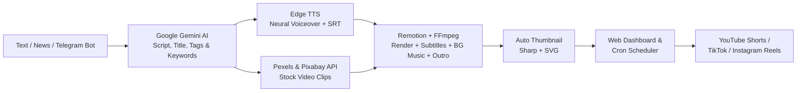

# Vidoza — Open-Source AI Short Video Generator & Auto-Poster

<p align="center">
  <strong>Self-hosted AI faceless video automation platform for YouTube Shorts, TikTok, and Instagram Reels.</strong><br/>
  Turn any news, article, or text prompt into a ready-to-publish vertical or horizontal video with AI scripting, neural voiceover, animated subtitles, stock footage, and automated multi-platform scheduling.
</p>

<p align="center">
  
  
  
  
  
</p>

---

## What is Vidoza?

**Vidoza** is an open-source, self-hosted **AI short-form video generator** and **social media scheduler**. Whether you are running faceless YouTube Shorts channels, automated news/story TikTok accounts, or Instagram Reels pages, Vidoza automates the entire production and publishing pipeline from a single web dashboard or Telegram bot.

### End-to-End Automation Pipeline



---

## Key Features

- **AI Script, Title & Hashtag Generation**: Powered by **Google Gemini (`gemini-2.5-flash`)** to rewrite raw news, articles, or ideas into engaging short-form scripts with SEO titles, descriptions, and tags.
- **Automatic Stock Video Sourcing**: Extracts visual scene keywords (with location awareness) and fetches HD footage from **Pexels** and **Pixabay** with automatic fallback.
- **Neural Text-to-Speech (TTS) & Word-Level Subtitles**: Uses **Microsoft Edge TTS (`msedge-tts`)** with multi-language support (**English, Turkish, Spanish**) and automatically synced subtitles.
- **Programmatic Video Rendering**: Combines **Remotion** and **FFmpeg** to render crisp `1080x1920` (9:16 vertical) or `1920x1080` (16:9 horizontal) videos with background music, dynamic captions, and customizable outros.
- **Automated Custom Thumbnails**: Generates high-contrast branded thumbnails automatically using **FFmpeg** and **Sharp**.
- **Multi-Account OAuth & Visual Calendar Scheduler**: Connect multiple **YouTube**, **TikTok**, and **Instagram** accounts, approve generated videos, and schedule automated publishing via built-in cron jobs.
- **Telegram Bot Integration**: Send text directly to your Telegram bot to trigger video generation, preview the rendered short, and approve or regenerate on the go.
- **Task Presets & Batch Creation**: Organize channels as Tasks (language, voice, duration preset `15-30s` up to `10+ min`, orientation, theme) and bulk-create jobs using `##` separators.
- **100% Self-Hosted & Lightweight**: Runs locally or on any VPS with **Node.js** and **SQLite** — no external database server required.

---

## Tech Stack

| Layer | Technology |
| :--- | :--- |
| **Backend & Auth** | Node.js, Express.js, `express-session` + SQLite session store |
| **Database** | SQLite (`better-sqlite3`) |
| **AI Engine** | Google Gemini API (`@google/generative-ai`) |
| **Video & Graphics** | Remotion, FFmpeg (`fluent-ffmpeg`), Sharp |
| **Voice & Subtitles** | Microsoft Edge TTS (`msedge-tts`), `subtitle` (SRT parser) |
| **Stock Media** | Pexels API, Pixabay API |
| **Publishing APIs** | YouTube Data API v3 (`googleapis`), TikTok Content Posting API, Instagram Graph API |
| **Bot & UI** | `node-telegram-bot-api`, EJS templates, custom calendar UI |

---

## Prerequisites

- **Node.js** v18 or higher
- **FFmpeg** installed and available in your system `PATH`
  - macOS: `brew install ffmpeg`
  - Ubuntu/Debian: `sudo apt install ffmpeg`
- API keys for **Google Gemini** and **Pexels** / **Pixabay** (free tiers work)

---

## Quick Start

1. **Clone the repository**:
   ```bash
   git clone https://github.com/enveryurtsever/vidoza.git
   cd vidoza
   ```

2. **Install dependencies**:
   ```bash
   npm install
   ```

3. **Configure environment variables**:
   ```bash
   cp .env.example .env
   ```
   Open `.env` and fill in your API keys and dashboard credentials.

4. **Start the server**:
   ```bash
   npm start
   # Or with hot-reload for development:
   npm run dev
   ```

5. **Open the dashboard**:
   - Visit `http://localhost:3000`
   - Log in with the `DASHBOARD_USERNAME` and `DASHBOARD_PASSWORD` you set in `.env` (default in `.env.example`: `admin` / `admin123` — change these before deploying).

---

## Environment Variables

| Variable | Required | Description |
| :--- | :---: | :--- |
| `GEMINI_API_KEY` | Yes | Google Gemini API key for script, keyword, and metadata generation |
| `PEXELS_API_KEY` | Yes* | Pexels API key for HD stock video search |
| `PIXABAY_API_KEY` | Optional* | Pixabay API key (used as secondary stock media source) |
| `DASHBOARD_USERNAME` | Yes | Login username for the web dashboard |
| `DASHBOARD_PASSWORD` | Yes | Login password for the web dashboard |
| `SESSION_SECRET` | Yes | Secret string used to sign Express sessions |
| `TELEGRAM_BOT_TOKEN` | Optional | Telegram Bot token for mobile video creation & approval |
| `TELEGRAM_ADMIN_CHAT_ID` | Optional | Default Telegram chat ID for job notifications |
| `YOUTUBE_CLIENT_ID` / `SECRET` | Optional | Google OAuth credentials for YouTube Shorts auto-upload |
| `TIKTOK_CLIENT_KEY` / `SECRET` | Optional | TikTok Developer credentials for TikTok publishing |
| `FACEBOOK_APP_ID` / `SECRET` | Optional | Meta/Facebook App credentials for Instagram Reels publishing |
| `PORT` | Optional | Server port (default: `3000`) |
| `TTS_SPEED` | Optional | Voiceover speed multiplier (default: `1.0`) |
| `JOB_TIMEOUT_MS` | Optional | Max render timeout per job in milliseconds (default: `900000`) |

*\*At least one stock media API key (`PEXELS_API_KEY` or `PIXABAY_API_KEY`) is recommended.*

---

## Supported Languages & Voices

Vidoza ships with built-in neural voice presets via Edge TTS and can be easily extended in `src/languages.js`:

- **English (`en`)**: Andrew, Jenny, Aria
- **Turkish (`tr`)**: Ahmet, Emel, Ava Multilingual
- **Spanish (`es`)**: Jorge, Dalia, Salome

---

## Use Cases

- **Faceless YouTube Shorts Automation**: Turn daily news or educational facts into vertical shorts automatically.
- **TikTok & Instagram Reels Content Pipeline**: Batch-generate 10+ videos at once and schedule them across multiple channels.
- **News & Media Summaries**: Forward breaking news to the Telegram bot and receive a subtitled video clip in minutes.

---

## Security

- All dashboard routes and API endpoints are protected by session-based authentication (`requireLogin`).
- All API keys, OAuth client secrets, and credentials are loaded exclusively from environment variables (`.env` is gitignored).
- Always set a strong `SESSION_SECRET`, `DASHBOARD_PASSWORD`, and `NODE_ENV=production` when deploying to a public server.

---

## License

Ensure you comply with the Terms of Service of all integrated third-party APIs (Google Gemini, YouTube, TikTok, Meta/Instagram, Pexels, Pixabay).
